# Post-contenido — Unidad 12: Despliegue y CI/CD

## Información del Estudiante
* **Nombre:** Andrea Valentina Rivera Fernández
* **Código:** 1152444
* **Institución:** Universidad Francisco de Paula Santander (UFPS)
* **Carrera:** Ingeniería de Sistemas
* **Materia:** Programación Web
* **Unidad:** 12
* **Año:** 2026

## Descripción

Repositorio del laboratorio de la Unidad 12 de Programación Web. Contiene la
aplicación Spring Boot del catálogo de productos (Unidad 10) dockerizada con un
Dockerfile multi-stage y perfiles dev/prod (Parte 1), y su extensión con un
pipeline de integración continua con GitHub Actions y monitoreo con Spring Boot
Actuator (Parte 2).


## Parte 1 — Dockerización con perfiles y variables de entorno

El Dockerfile compila el proyecto con Maven en una etapa con JDK y ejecuta el
JAR resultante en una etapa JRE Alpine con un usuario no root. La configuración
sensible se externaliza en `application.properties` con placeholders
`${VAR:default}`: sin variables de entorno la aplicación arranca con el perfil
`dev` (H2 en memoria); con `SPRING_PROFILES_ACTIVE=prod` y las variables
`DATASOURCE_URL`, `DATASOURCE_USER` y `DATASOURCE_PASSWORD` arranca con la
configuración de producción (PostgreSQL).

## Parte 2 — Pipeline CI/CD con GitHub Actions y monitoreo con Actuator

El pipeline (`.github/workflows/ci.yml`) se activa en cada push a `main` y:

1. **build-and-test:** compila con Maven y ejecuta las pruebas (`mvn clean verify`,
   incluida la verificación de cobertura de JaCoCo) y publica el reporte de pruebas.
2. **docker-build** (depende del anterior con `needs`): construye la imagen
   Docker con el mismo Dockerfile de la Parte 1, levanta el contenedor dentro del
   runner y hace un smoke test: consulta `/actuator/health` hasta obtener `UP`.
   La imagen no se publica en ningún registro externo.

## Variables de entorno

| Variable | Perfil | Valor por defecto | Descripción |
|---|---|---|---|
| `SPRING_PROFILES_ACTIVE` | ambos | `dev` | Perfil activo |
| `PORT` | ambos | `8080` | Puerto del servidor |
| `DATASOURCE_URL` | ambos | H2 en memoria (dev) / PostgreSQL local (prod) | URL JDBC |
| `DATASOURCE_USER` | ambos | `sa` (dev) / `appuser` (prod) | Usuario de la base |
| `DATASOURCE_PASSWORD` | ambos | vacío | Contraseña de la base |
| `DDL_AUTO` | prod | `update` | Estrategia de esquema de Hibernate |

## Decisiones de diseño

### Parte 1
1. **Placeholders con valor por defecto** (`${VAR:default}`) en vez de
   placeholders estrictos: la misma imagen arranca en local y en el pipeline sin
   exportar variables, y producción sobrescribe cada valor. No se aplica a
   credenciales de producción, que no deben tener un valor por defecto usable.
2. **`application-dev.properties` y `application-prod.properties` separados**:
   la separación física hace evidente qué configuración corresponde a cada
   ambiente y reduce el riesgo de editar producción por error.
3. **Imagen final JRE Alpine** en vez de distroless: reduce el tamaño frente al
   JDK completo y conserva un shell mínimo para depurar con `docker exec`.
4. **Etapa de compilación con la imagen oficial de Maven**: la imagen
   `eclipse-temurin` con JDK no incluye Maven.
5. **`ddl-auto=update` en producción**: con una base vacía, `validate` impediría
   el primer arranque. En un proyecto real se usaría una herramienta de
   migraciones (Flyway o Liquibase) y `validate`.

### Parte 2
1. **Se reutilizan las pruebas del proyecto** en vez de escribir una prueba
   mínima nueva: el job de pruebas valida comportamiento real (servicio,
   repositorio, controlador y contexto de Spring).
2. **El job `docker-build` verifica pero no publica la imagen**: evita exigir
   cuentas externas y Secrets para aprobar el laboratorio. El smoke test valida
   lo importante: que la imagen arranca y expone el endpoint de monitoreo.
3. **Exposición de Actuator diferenciada por perfil** (todo en dev, solo `health`
   e `info` en prod): evita exponer información sensible como `env` o `beans`.
4. **Smoke test con 30 intentos**: el arranque de Spring Boot en el runner puede
   tardar más de 30 segundos y 15 intentos daban falsos fallos.

## Cómo compilar y ejecutar

1. Clonar: `git clone https://github.com/Andrea-Rivera31/rivera-post1-u12.git`
2. Construir la imagen: `docker build -t mi-spring-app:local .`
3. Perfil dev: `docker run -p 8080:8080 mi-spring-app:local`
4. Perfil prod (con un PostgreSQL accesible):
   ```
   docker run -p 8080:8080 -e SPRING_PROFILES_ACTIVE=prod \
     -e DATASOURCE_URL=jdbc:postgresql://HOST:5432/appdb \
     -e DATASOURCE_USER=appuser -e DATASOURCE_PASSWORD=CLAVE \
     mi-spring-app:local
   ```
5. Estado: `curl http://localhost:8080/actuator/health`
6. Pipeline: pestaña **Actions** del repositorio.

## Capturas de pantalla

### Parte 1

Imagen Docker construida localmente (menos de 300 MB):

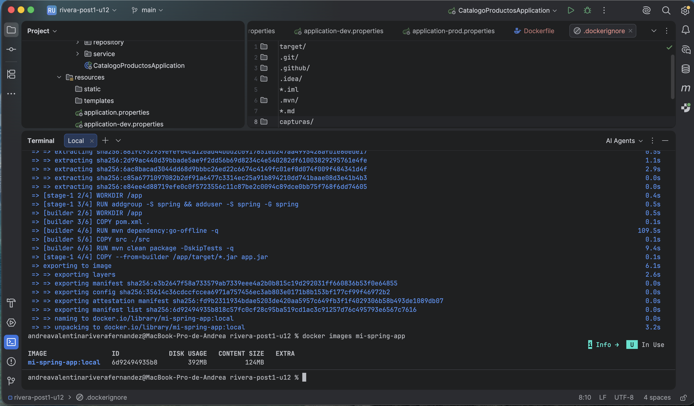

Contenedor con el perfil dev, sin variables de entorno:

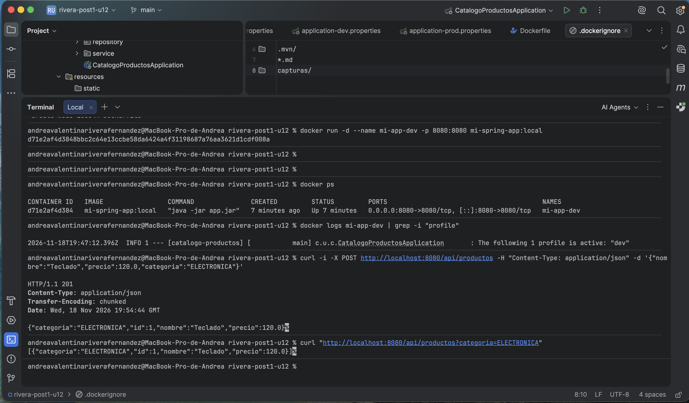

Logs del contenedor con el perfil prod:

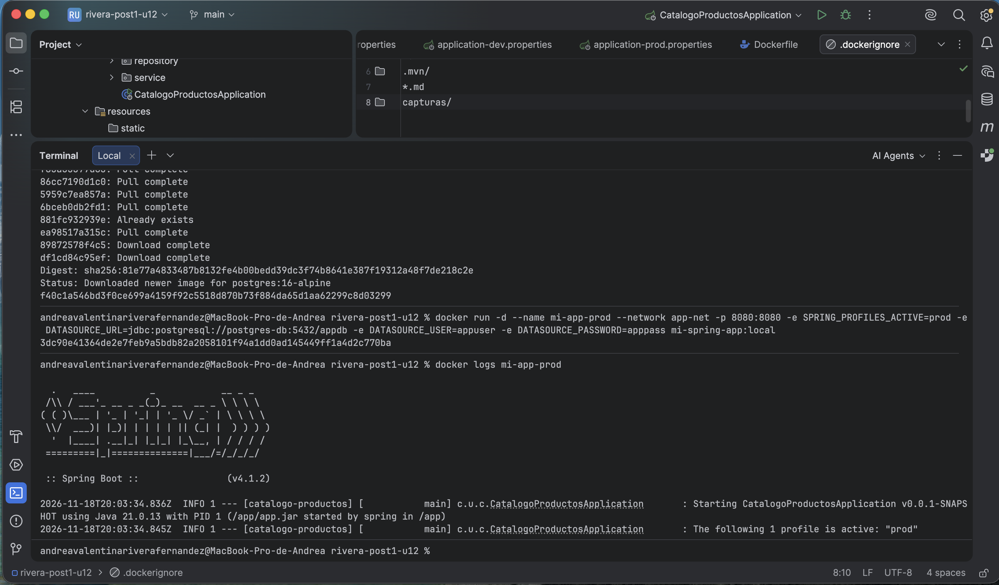

Historial de commits de la Parte 1:

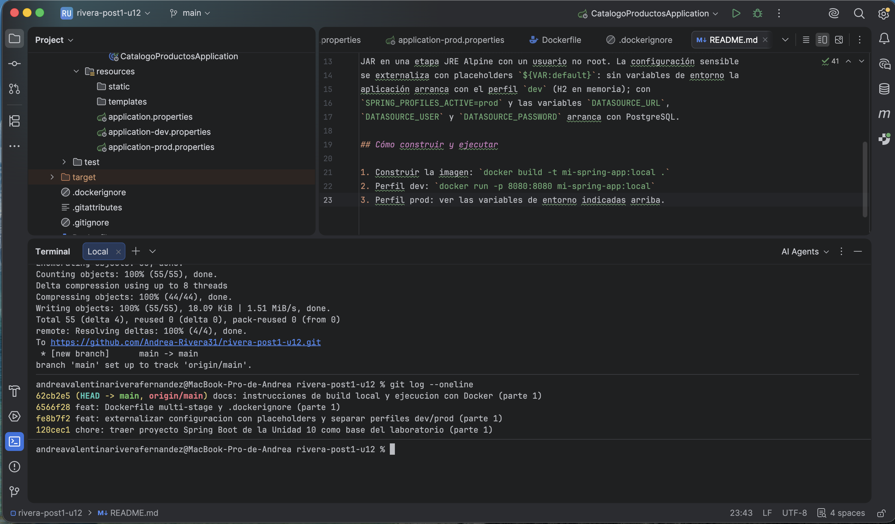

### Parte 2

Contenedor respondiendo UP en `/actuator/health`:

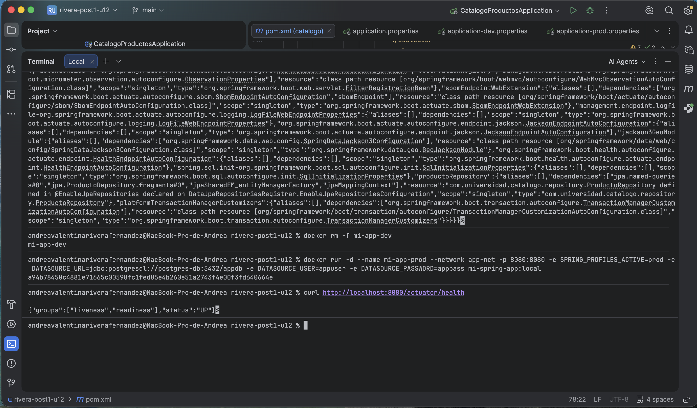

En prod, `/actuator/beans` responde 404:

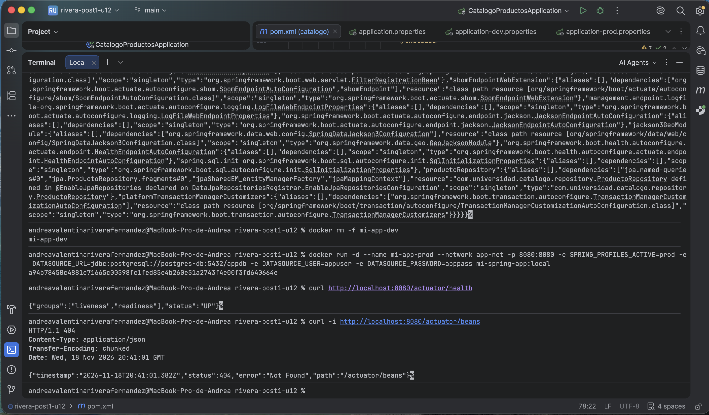

Smoke test dentro del pipeline:

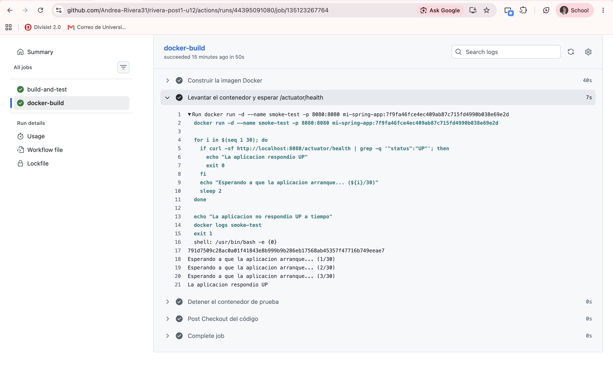


## Despliegue (paso final manual)

La aplicación está desplegada en Railway a partir del mismo Dockerfile, con las variables de entorno configuradas en el panel de la plataforma y una base de datos PostgreSQL gestionada por Railway.

- URL de la aplicación: https://rivera-post1-u12-production.up.railway.app
- Estado: https://rivera-post1-u12-production.up.railway.app/actuator/health

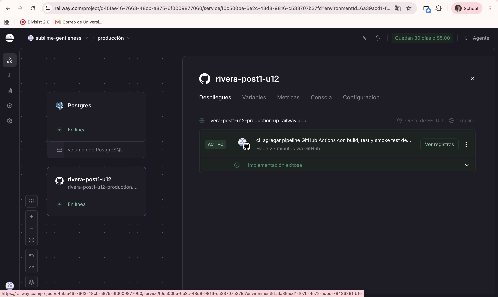

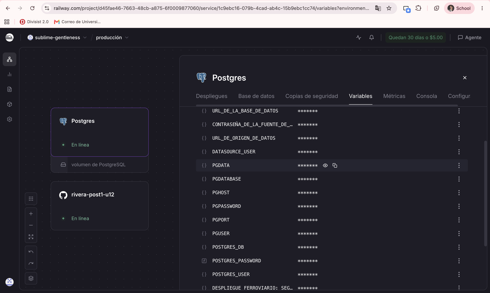

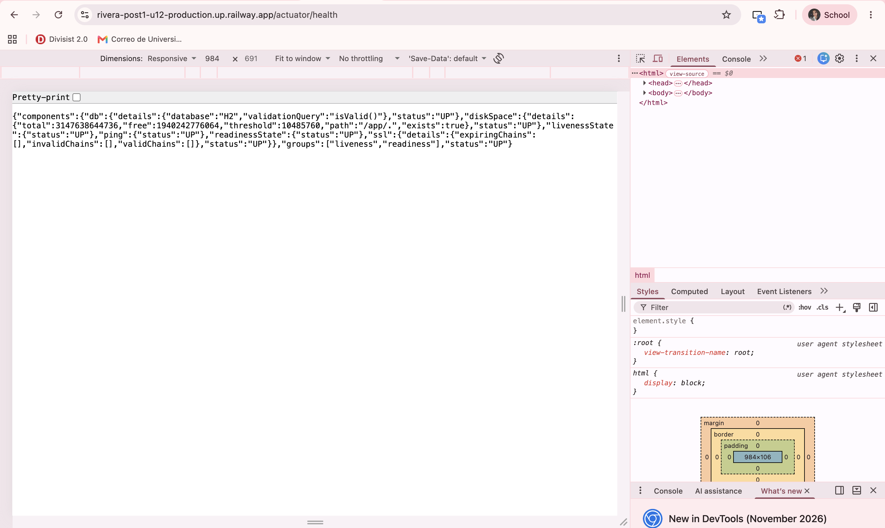

### Historial del pipeline

Ejecuciones exitosas de GitHub Actions:

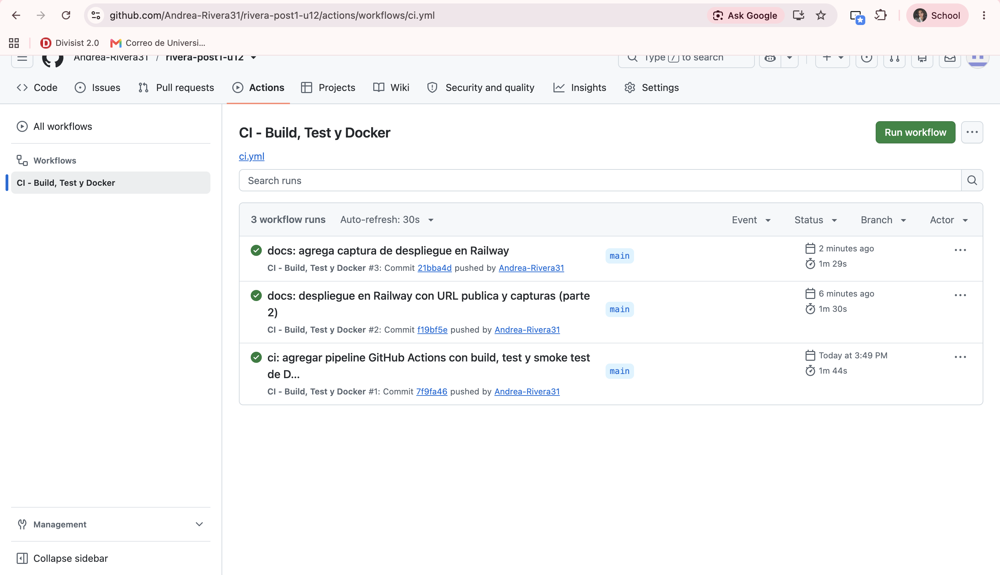